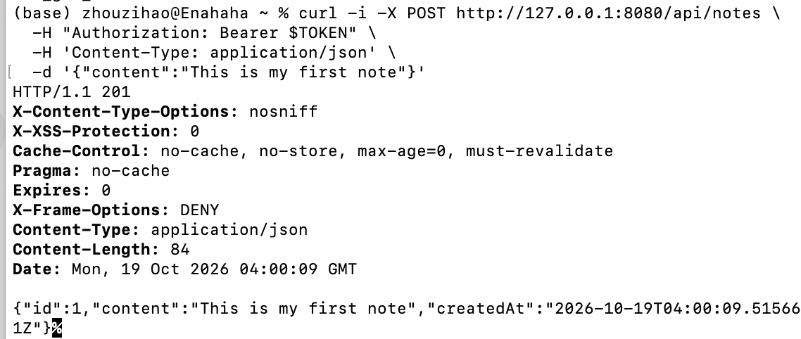
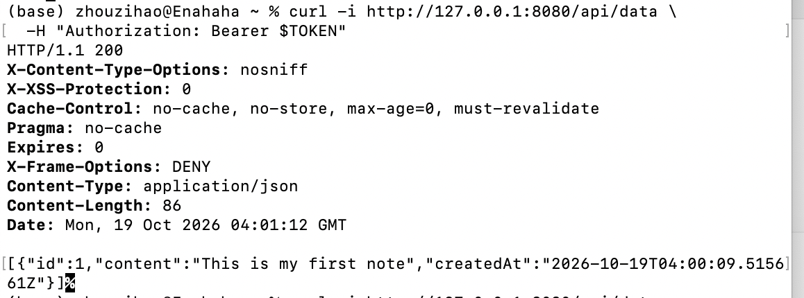
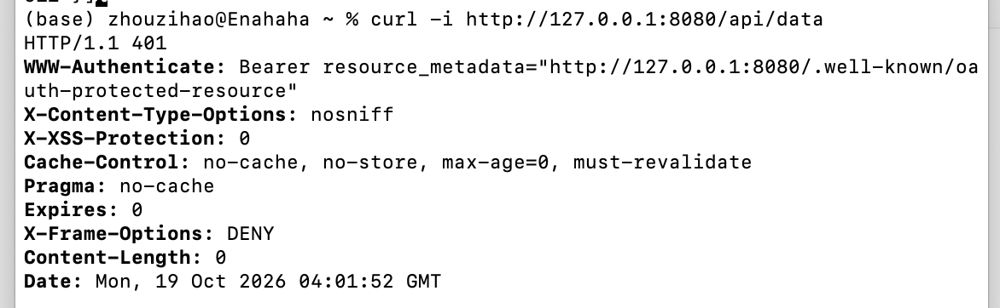
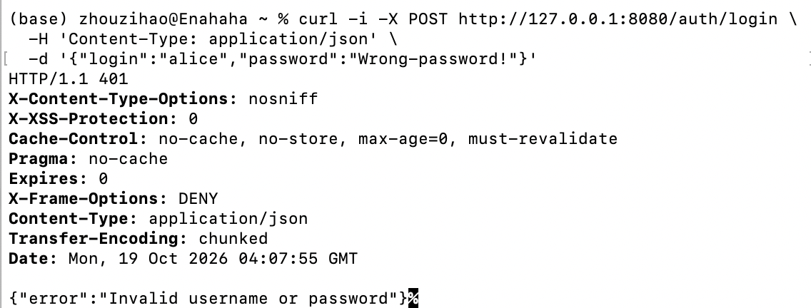
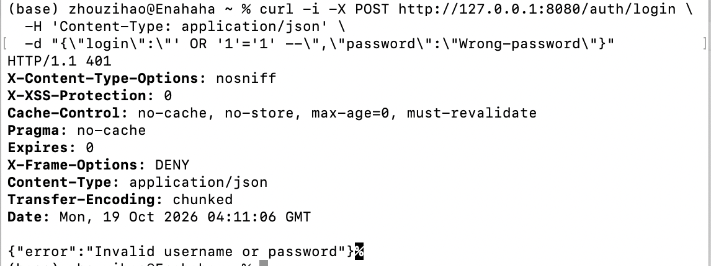
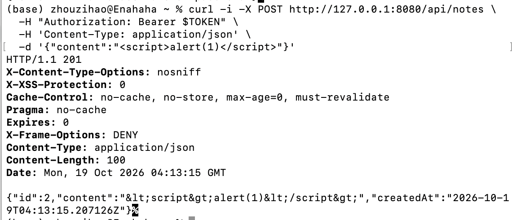
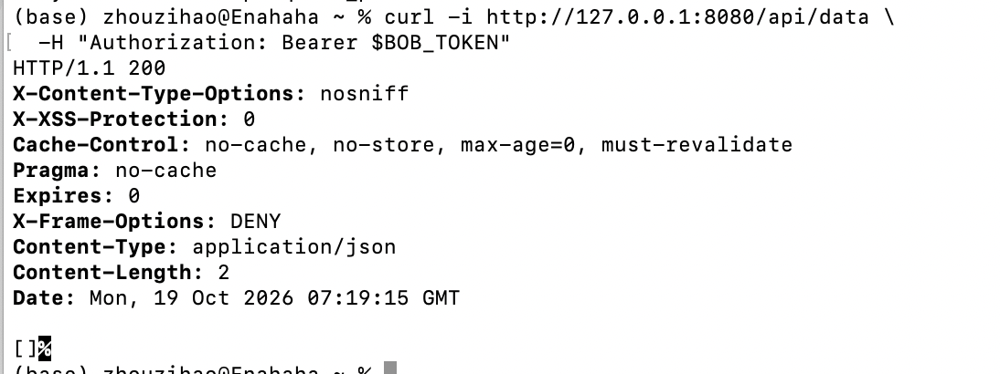
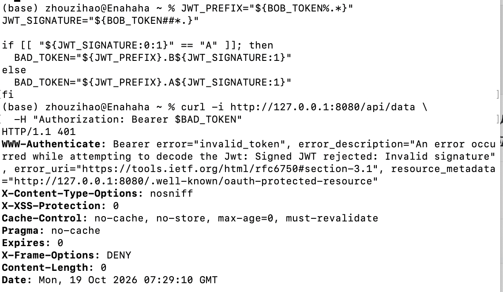

# Work 1 — API functional and access-control screenshots

These screenshots were captured from actual `curl` requests against the local
API. They are ordered by login, note creation, note reading and unauthenticated
access. The images were copied and renamed only; the results were not cropped or
edited.

| File | Request | Observed result |
|---|---|---|
| `01_login_success_200.png` | `POST /auth/login` with valid credentials | 200 + JWT |
| `02_create_note_authenticated_201.png` | `POST /api/notes` with Bearer JWT | 201 + created note |
| `03_get_notes_authenticated_200.png` | `GET /api/data` with Bearer JWT | 200 + own notes |
| `04_get_notes_without_token_401.png` | `GET /api/data` without a token | 401 |
| `05_login_wrong_password_401.png` | `POST /auth/login` with a wrong password | 401 |
| `06_login_sqli_attempt_401.png` | `POST /auth/login` with an SQLi-style username | 401 |
| `07_create_note_xss_escaped_201.png` | `POST /api/notes` with `` | 201, response contains `&lt;script&gt;` |
| `08_get_notes_bob_empty_200.png` | `GET /api/data` with Bob's token | 200 + `[]` |
| `09_tampered_jwt_signature_rejected_401.png` | `GET /api/data` with a modified JWT signature | 401 `Invalid signature` |

## Report captions

### Figure 1 — Successful login and JWT issuance

User alice logs in with the correct credentials. The server returns a JWT with
`tokenType` Bearer and `expiresIn` 1800 seconds.

Response-header time converted to Beijing time: 2026-10-19 11:52:56 (UTC+8).

### Figure 2 — Creating a note with a JWT

The client sends a JWT and creates a note. The server returns the new note's ID,
content and creation time.

Response-header time converted to Beijing time: 2026-10-19 12:00:09 (UTC+8).

### Figure 3 — Reading notes with a JWT

The client accesses the data endpoint with a JWT and receives the note created
in the previous step.

Response-header time converted to Beijing time: 2026-10-19 12:01:12 (UTC+8).

### Figure 4 — Access without a JWT is rejected

When no `Authorization` token is provided, the server returns HTTP 401 and
rejects access to the protected data endpoint.

Response-header time converted to Beijing time: 2026-10-19 12:01:52 (UTC+8).

### Figure 5 — Wrong password is rejected

alice logs in with a wrong password. The server returns HTTP 401 with the
uniform message `Invalid username or password` and does not issue a JWT.

Response-header time converted to Beijing time: 2026-10-19 12:07:55 (UTC+8).

### Figure 6 — SQL-injection-style username does not bypass login

A login request is sent with a username containing a SQL fragment
(`' OR '1'='1' --`). The server returns HTTP 401 and does not issue a JWT. This
shows that the input did not bypass login; the SQL-injection protection itself
is explained by the Spring Data parameter binding in the repositories.

Response-header time converted to Beijing time: 2026-10-19 12:11:06 (UTC+8).

### Figure 7 — Script markup is escaped in the response

After submitting ``, the server returns HTTP 201 and the
response `content` is `&lt;script&gt;alert(1)&lt;/script&gt;`. This shows HTML
text output escaping for the note-creation response. The screenshot does not
involve browser execution and does not by itself prove that every front-end
context is free of XSS.

Response-header time converted to Beijing time: 2026-10-19 12:13:15 (UTC+8).

### Figure 8 — Bob's query returns an empty array

Using Bob's token (variable `BOB_TOKEN`) obtained in the earlier steps, the
client calls `GET /api/data`. The server returns HTTP 200 with an empty array
`[]`. Together with Figure 3, where Alice receives the note she created, this is
paired evidence for user-data isolation. The screenshot itself only shows the
variable name, not Bob's identity; the report should also describe Bob's login
and the variable assignment.

Response-header time converted to Beijing time: 2026-10-19 15:19:15 (UTC+8).

### Figure 9 — Tampered JWT signature is rejected

The signature is taken from Bob's JWT, its first character is changed while the
header and payload are kept unchanged, and the resulting `BAD_TOKEN` is sent to
`GET /api/data`. The server returns HTTP 401; the `WWW-Authenticate` response
header contains `invalid_token` and `Signed JWT rejected: Invalid signature`.
Together with the successful request with the original token in Figure 8, this
shows JWT signature validation.

Response-header time converted to Beijing time: 2026-10-19 15:29:10 (UTC+8).

## Evidence scope

This set of screenshots shows the actual results of login, authenticated note
creation and reading, rejection of unauthenticated access, rejection of a wrong
password, and one SQL-injection-style input that did not bypass login. Figure 7
shows HTML text escaping in the note-creation response. Figures 3 and 8 together
show user-data isolation; Figure 9 shows rejection of a tampered JWT signature.
The set still does not by itself prove comprehensive SQL-injection protection,
XSS protection in every output context, or rejection of expired tokens; it must
be read together with the code analysis and the corresponding tests.

The first original image contains the local demo password and the JWT from that
run; it is kept as-is per the user's request. For a public report, use a redacted
copy while keeping the original evidence in this directory.
